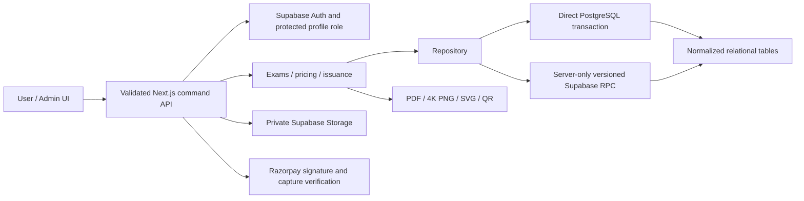

# Architecture

One Next.js modular monolith serves the public site, User portal and Admin portal. Server routes authenticate with Supabase, validate commands with Zod, enforce ownership/permissions, execute business rules, and commit changes atomically to typed relational PostgreSQL tables.

## Profiles and ownership

Only `user` and `admin` are accepted by both TypeScript and the database constraint. An Auth trigger creates User profiles from new authenticated accounts. User-editable metadata never controls authorization. Column grants prevent clients from changing their own role. RLS restricts account, enrollment, attempt, payment, document and support reads to the owner or an Admin. Private answer-key and internal tables have no client read grants or permissive policies.

The public repository RPC functions are security invokers with EXECUTE revoked from PUBLIC, anon and authenticated. Only the server credential may call them. Private helpers remain outside the exposed API schema. The only signed-in helper exposed through RLS is an `auth.uid()`-bound Admin predicate.

## Persistence

Live data uses seventeen typed tables with ownership/domain foreign keys, duplicate-enrollment constraints, one-active-attempt uniqueness, unique provider references, immutable issued-document fields and separate question snapshots, responses and violations. JSON is retained only for immutable question snapshots and the transport DTO, not as a generic entity database.

The direct PostgreSQL path holds an advisory transaction lock. The alternative REST path reads a versioned snapshot and commits only changed records under the same lock; a stale version is rejected before any writes. It does not silently overwrite other requests or automatically retry callbacks with external side effects. This is safe MVP persistence, but full-state reads remain a scaling limit.

The explicitly labelled local sandbox uses a single-process serialized file adapter. It is isolated from live data, excluded from Git and refused on Vercel. It is not a production database.

## Exams and credentials

An owned enrollment and versioned consent precede an attempt. Each attempt snapshots thirty questions with a 9/15/6 difficulty split and shuffled options. Only saved responses count; the server rejects late changes and finalizes expired attempts on subsequent requests. Grading requires at least 23/30 to pass. A learner may take at most five attempts per domain; after a pass, further attempts are blocked.

Confirmed browser exits are debounced and idempotent. The third distinct confirmed exit submits the attempt. Accessibility mode skips penalties. Native modal confirmation contains keyboard focus. Browser visibility/fullscreen events cannot prove misconduct.

Server-calculated pricing creates an order. Verified Razorpay capture or explicit local simulation grants the entitlement. Passing plus a paid entitlement issues each document kind once. Captures outside quoted early conditions are retained for finance review and do not issue documents. Revocation blocks downloads and appears in verification. QR records reveal only an abbreviated recipient name, domain, document type and issue/revocation status.

## Live target and pending configuration

Target: SKILLSETGOCOURCES in AgentTrap AI (`smdgqmmnqbhqqhkyqxok`). Migrations and catalogue were applied and queried through the Supabase connector. Public REST access to twelve published domains and rejection of unprivileged repository RPC access were verified. The private application credential and Google provider setup remain owner-supplied configuration; no completed live login/payment/deployment is implied.
